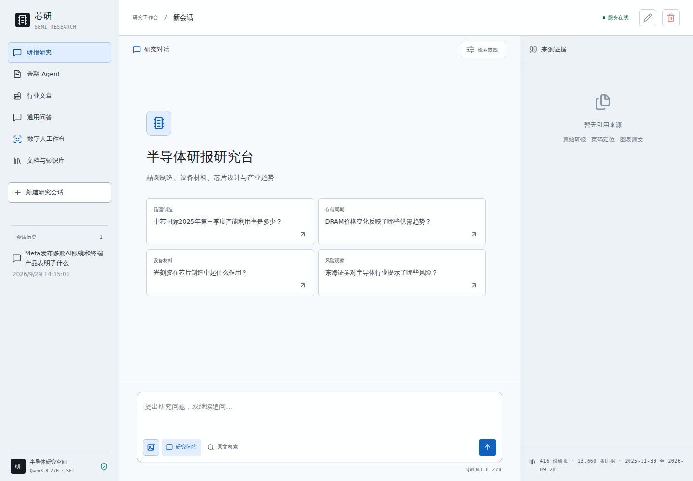
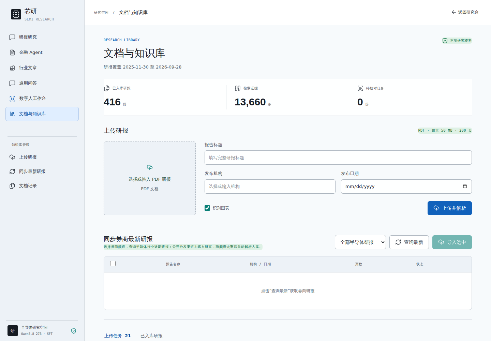
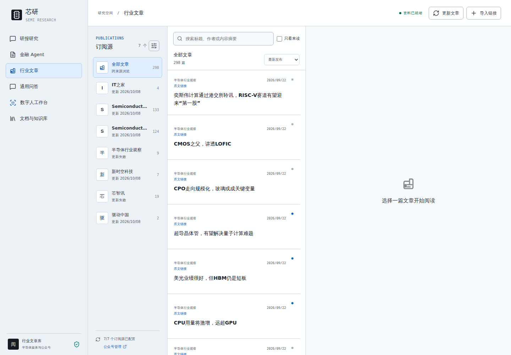
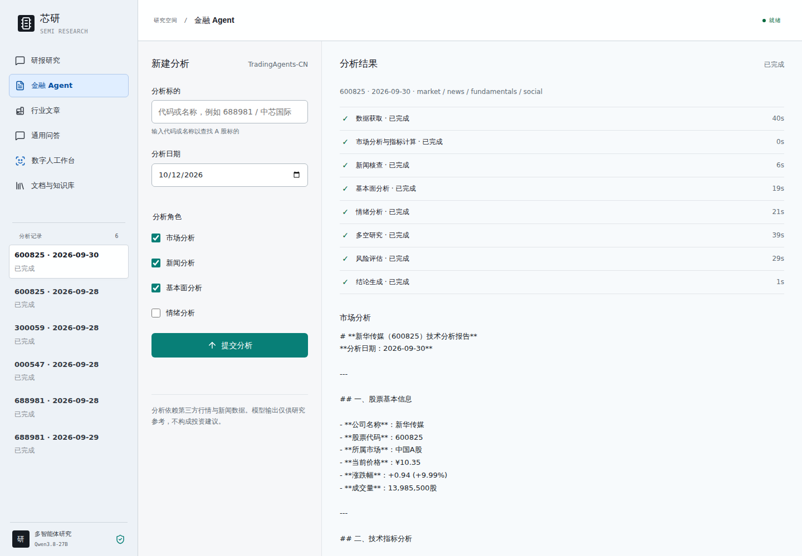
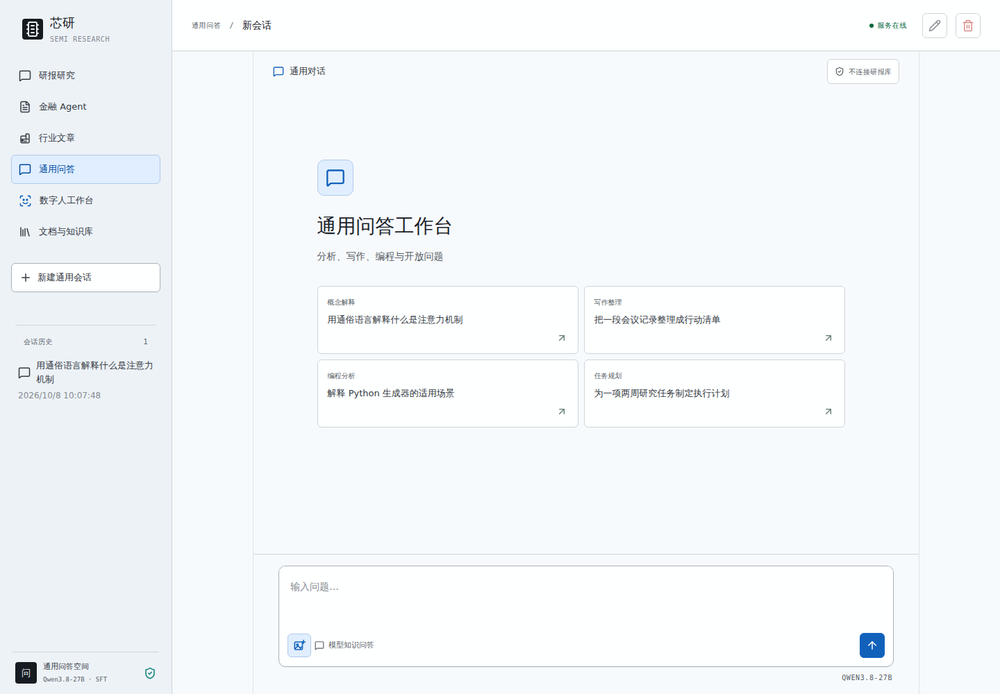
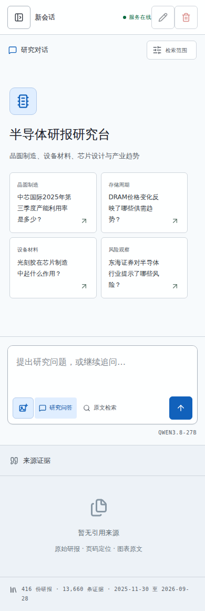
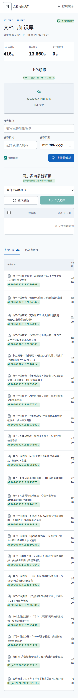
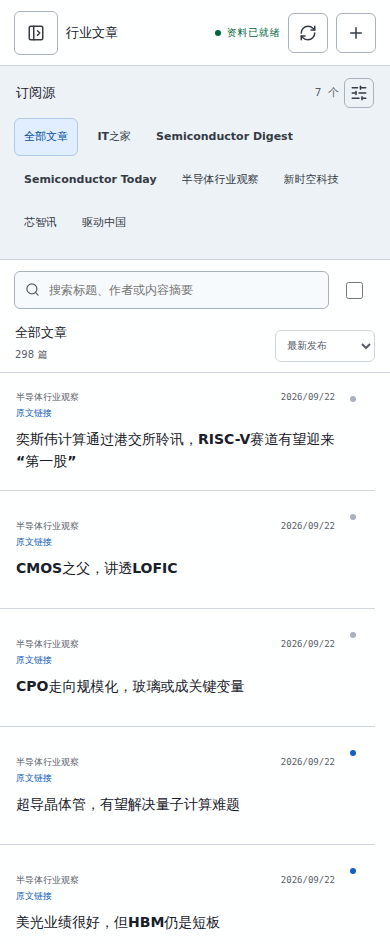

# Finance Semiconductor RAG

面向半导体行业研报研究的中文 RAG 工作台。项目包含 PDF 解析与清洗、页级/段落级证据切片、BM25 + Dense 混合检索、BGE 重排、引用溯源、流式问答、文档上传、文章采集、评测和本地企业部署模板。

> 本项目用于研究和工程验证，模型输出不构成投资建议。研报原文、模型权重、数据库和生产凭据不随仓库分发。

## 功能概览

- **PDF 语料构建**：分诊、双栏阅读顺序识别、表格转 Markdown、图表导出、元数据挂载、样板清洗、段落级 MinHash/LSH 去重。
- **证据切片**：保留文档 ID、页码、标题路径、父块/相邻块关系和内容哈希，回答时可回到 PDF 文件和原文位置。
- **RAG 检索**：中文 BM25、BGE-M3 向量召回、RRF/排名融合、BGE Cross-Encoder 重排、查询扩展和元数据过滤。
- **工作台**：研报研究、通用问答、文档库、PDF 校对入库、行业文章和金融 Agent 入口，支持流式输出与会话历史。
- **工程能力**：OIDC/Keycloak 认证、PostgreSQL 任务状态、Redis 队列、结构化日志、Prometheus 指标和压力测试脚本。

## 功能截图

以下截图来自本项目实际运行实例，展示核心工作台和移动端布局。截图只用于界面说明，不包含生产凭据、Cookie 或原始 PDF 文件。

### 研报研究工作台



### 文档与知识库



### 半导体行业文章



### 金融 Agent



### 通用问答



### 移动端适配





## 目录

```text
src/semi_rag/       RAG API、检索、答案生成、上传、任务和网页工作台
src/triage.py       PDF 分诊：页数、文字密度、图片密度和 OCR/VLM 标记
src/parse_pymupdf.py PyMuPDF 解析：双栏排序、表格抽取、图片导出、页码标记
src/metadata.py     研报标题与券商/日期/行业元数据匹配
src/clean.py        页眉页脚、免责声明、样板和断句清洗
src/dedup.py        段落级 MinHash + LSH 近重复去除
src/ingest.py       Parent-Child/页级切片、标题路径和相邻证据扩展
scripts/            服务、评测、索引和模型辅助脚本
tests/              单元和 API 集成测试
configs/            不含密钥的配置模板
infra/              PostgreSQL、Redis、Keycloak、Nginx 和 Prometheus 模板
migrations/         数据库迁移脚本
docs/               部署、接入、数据源和验收记录
```

## 快速启动

环境要求：Python 3.11/3.12、PyMuPDF、FastAPI；向量检索还需要 BGE-M3 和 Cross-Encoder 模型。生产部署另需 PostgreSQL 16、Redis 7、Keycloak 26 和 Nginx。

```bash
git clone https://github.com/JimmyWangE/finance-semiconductor-rag.git
cd finance-semiconductor-rag
python3 -m venv .venv-rag
source .venv-rag/bin/activate
pip install -r requirements-rag.txt
cp configs/rag.example.json configs/rag.json
export RAG_PDF_DIR="$PWD/data/pdfs"
export RAG_METADATA_CSV="$PWD/data/半导体_研报列表.csv"
export PYTHONPATH="$PWD/src"
python -m semi_rag build --config configs/rag.json
python -m semi_rag serve --host 127.0.0.1 --port 8090
```

浏览器访问 `http://127.0.0.1:8090/`。对外监听前必须设置 `RAG_API_KEY` 或使用受控内网参数 `--trusted-network`，生产环境建议由 Nginx 统一处理 HTTPS、认证和限流。

## PDF 解析与切片

原始 PDF 应放在 `RAG_PDF_DIR` 指定目录，元数据 CSV 由 `RAG_METADATA_CSV` 指定。以下命令会生成本地 `data/` 产物，该目录已被 Git 忽略：

```bash
cd src
python triage.py --pdf-dir "$RAG_PDF_DIR" --out ../data/report/triage.jsonl
python parse_pymupdf.py --triage ../data/report/triage.jsonl --out ../data/raw_md --workers 8
python metadata.py --pdf-dir "$RAG_PDF_DIR" --csv "$RAG_METADATA_CSV"
python clean.py
python dedup.py
python stats.py
```

也可以运行完整链路：`bash run_step1.sh`。

切片实现位于 `src/ingest.py`：文本按句末标点进行重叠切分，Markdown 表格单独保留表头，记录 `doc_id`、`page`、`parent_id`、`title_path`、`content_hash` 和 `position`。索引阶段再按页和相邻位置扩展上下文，避免回答只命中孤立句子。

## 检索、问答与评测

```bash
python -m semi_rag search "HBM 产能和长期供货协议" --mode rerank --top-k 6
python -m semi_rag ask "报告中对先进封装的判断是什么？" --answer-policy best_effort
python scripts/benchmark_rag.py --help
python scripts/compare_retrieval.py --help
```

评测报告应同时记录 Precision@K、Recall@K、HitRate、MRR、nDCG、QPS、P95/P99、错误率和问答回归结果。指标定义和报告格式见 [BENCHMARK.md](BENCHMARK.md)。

## 模型配置

仓库不包含模型权重。推荐通过 OpenAI 兼容服务提供生成模型，并在 `configs/rag.json` 或环境变量中配置：

```text
RAG_CONFIG=/path/to/rag.json
RAG_DEVICE=cuda:0
RAG_LLM_BASE_URL=http://127.0.0.1:8000/v1
RAG_LLM_MODEL=Qwen3.8-27B
VLLM_API_KEY_FILE=/secure/path/vllm_api_key
```

Embedding 和 Reranker 目录分别由 `embedding_model`、`reranker_model` 指定，代码使用本地文件加载，不会在服务启动时自动下载权重。

## 企业部署

推荐拓扑为：应用服务监听 8090，Keycloak 8180，PostgreSQL 5432，Redis 6379，Nginx 对外暴露 189。初始化、迁移、回滚和健康检查见 [SERVICE_STARTUP.md](SERVICE_STARTUP.md)、[docs/LOCAL_ENTERPRISE_STACK.md](docs/LOCAL_ENTERPRISE_STACK.md) 和 [migrations/](migrations/)。

所有 `infra/secrets/`、数据库目录、运行日志和生产配置均已排除，不应复制到公开仓库。

## 测试

```bash
export PYTHONPATH="$PWD/src"
pytest -q tests
```

不连接外部模型的测试可直接运行；真实模型、行情数据和压力测试需要额外配置服务地址、API Key 和测试数据集。

## 数据与许可证边界

- 研报 PDF、清洗语料、向量索引、对话数据库和截图属于运行数据，不随代码发布。
- Qwen、BGE 及其他模型遵循各自许可证，使用者需自行获取并确认授权。
- 行情和研报来源的版权、robots 和转载限制由部署方负责确认。
- 本仓库当前未声明统一开源许可证；第三方组件和上游项目遵循其原许可证。公开发布前请由项目所有者补充适用的 LICENSE 和版权边界。

## 贡献

提交 Issue 或 Pull Request 时请提供复现步骤、环境版本和脱敏日志。不要在 Issue、提交记录或截图中粘贴 API Key、Cookie、密码、内部 IP 或研报原文。
